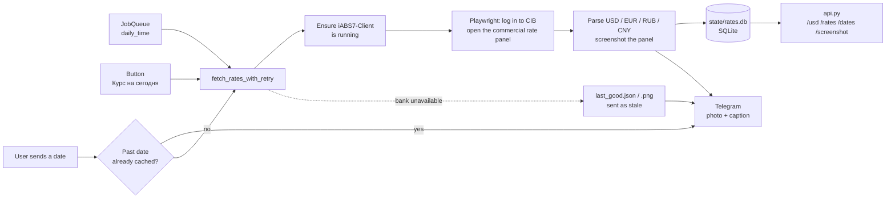

# USD Rate Bot

**A Telegram bot that logs into a corporate internet bank, captures the official commercial USD rate panel as a screenshot and posts it to a team group every morning, with a local HTTP API on top of its rate cache.**


## Overview

At a retail & fintech company in Uzbekistan, prices and settlements depend on the bank's **commercial** USD rate, which is published only inside the bank's Corporate Internet Banking (CIB) portal. It is not available on the public website, so every morning someone had to log in, open the right panel and share the number with the team.

This bot does that job automatically. It drives a real Chromium browser with Playwright, logs into the CIB, switches the rate panel to "Commercial rate", parses USD / EUR / RUB / CNY, takes a screenshot of the panel and posts it to a Telegram group at a fixed time. Team members can also ask for today's rate or the rate for any past date. Every successful fetch is stored in SQLite, and a small HTTP API serves those cached rates to other internal tools without logging into the bank again.

## Features

- **Daily post on a schedule.** Uses the python-telegram-bot `JobQueue` in the configured time zone (default 09:00 Asia/Tashkent).
- **On-demand rate.** The reply-keyboard button **"📊 Курс на сегодня"** fetches the current rate. A short cooldown cache stops repeated presses from triggering repeated bank logins.
- **Rate for any date.** Send `10.09.2026`, `10.09`, `1.9.26`, `10/09/2026` or `2026-09-10`. Past dates come straight from the SQLite cache with the original screenshot. Other dates are fetched from the bank. Dates later than tomorrow are rejected without contacting the bank.
- **Robust parsing.** Handles NBSP and thin-space thousand separators, 2 or 4 decimals and comma or dot as the decimal mark. Cross-rate rows are ignored.
- **Date walk-back.** Overnight the bank opens the next business day before the USD row is published. In that case the scraper steps the panel's date back (up to 6 days) and labels the post with the date the rate actually belongs to.
- **Layered fallbacks.**
  - The screenshot is taken of the panel first, then the whole frame, then the whole page. If Telegram rejects the photo, the bot sends the numbers as plain text.
  - If the bank is unreachable, the bot posts the last known good rate, clearly marked as stale, and privately tells the admins why.
  - A failed daily post is retried every 10 minutes (up to 8 attempts). If the bot was offline at post time, it catches up on startup.
- **Careful retry policy.** Transient failures are retried with exponential backoff and jitter. Permanent ones (wrong password, blocked account) stop immediately so they don't lock the account. Every run logs out in a `finally` block and confirms the "Are you sure?" dialog, so failed attempts don't leave CIB sessions open.
- **Bank-specific plumbing.** The bank checks the device's MAC address through a local helper app (iABS7-Client on `localhost`). The bot checks that the helper is running and starts it if needed, and launches Chromium with the Local Network Access checks disabled so the page can reach it.
- **Built-in diagnostics.** On a parse or login failure it saves a debug screenshot plus the page text. The folder is automatically pruned to the 60 newest files.
- **HTTP API** (`api.py`). Read-only JSON API over the cache. It keeps rows in memory and reloads only when the SQLite file (including the `-wal` file) changes, so lookups don't hit the database each time. It binds to `127.0.0.1` by default because it has no authentication.
- **Access control.** The bot responds only in the configured group or to whitelisted user IDs, and silently ignores everyone else.

## How it works



## Tech stack

| Area | Tools |
|---|---|
| Language | Python 3.10+ (`asyncio`) |
| Telegram | python-telegram-bot 22 with the `job-queue` extra |
| Browser automation | Playwright (async API, Chromium) |
| Storage | SQLite in WAL mode (`sqlite3`), JSON state files |
| HTTP API | Standard library `http.server` (`ThreadingHTTPServer`) |
| Runtime | Windows (the bank's iABS7-Client helper is Windows-only) |

## Project structure

```
usd-rate-bot/
├── bot.py                    # Telegram bot: schedule, button, date requests, fallbacks
├── bank_scraper.py           # Playwright scraper for the CIB rate panel (+ CLI for testing)
├── rate_store.py             # SQLite cache of rates and screenshots, keyed by date
├── api.py                    # Local read-only HTTP API over the cache
├── get_chatid.py             # Helper: print chat_ids the bot can see
├── run_bot.bat               # Double-click launcher for Windows
├── config.example.json       # Template for config.json
├── credentials.example.json  # Template for credentials.json
└── requirements.txt
```

Created at runtime (git-ignored): `state/` (`rates.db`, `last_good.json/png`, `last_post.json`), `debug_screenshots/`, `bot.log`.

## Setup

```bash
pip install -r requirements.txt
python -m playwright install chromium
```

Then create your local config files from the templates:

```powershell
Copy-Item config.example.json config.json
Copy-Item credentials.example.json credentials.json
```

**`credentials.json`**: CIB login and password (`login`, `password`).

**`config.json`**:

| Key | Required | Default | Description |
|---|---|---|---|
| `bot_token` | yes | — | Bot token from @BotFather |
| `group_chat_id` | yes | — | Telegram group the daily rate is posted to |
| `allowed_user_ids` | no | `[]` | Users who may use the bot outside the group. They also receive failure alerts |
| `daily_time` | no | `"09:00"` | Daily post time, `HH:MM` |
| `timezone` | no | `"Asia/Tashkent"` | IANA time zone for the schedule and "today" |
| `bank_url` | no | CIB login page | Login page of the bank's CIB |
| `rate_cooldown_seconds` | no | `120` | Reuse the last fetched rate for this long between button presses |
| `daily_retry_delay_seconds` | no | `600` | Delay between retries of a failed daily post |
| `daily_max_attempts` | no | `8` | Max attempts for the daily post. The last attempt posts stale data rather than nothing |
| `api_host` / `api_port` | no | `127.0.0.1` / `8777` | Bind address of `api.py` |

The bank requires its **iABS7-Client** helper to be installed once on the machine (the standard installer the bank provides for browser logins). The bot only starts it; it does not install it.

## Usage

```bash
python bot.py                        # run the bot (keep exactly one instance running)
python bank_scraper.py               # one-off scrape: prints JSON, saves panel_preview.png
python bank_scraper.py --headed      # same, with a visible browser window for debugging
python bank_scraper.py 10.09.2026    # rate for a specific date
python api.py                        # start the HTTP API
python rate_store.py                 # list cached dates
python get_chatid.py                 # find the group's chat_id (stop bot.py first)
```

**In Telegram**

| Input | Result |
|---|---|
| `/start` | Shows the keyboard with the **📊 Курс на сегодня** button |
| 📊 Курс на сегодня | Current commercial USD rate with the panel screenshot |
| `10.09.2026` (any common date format) | Rate for that date. If no rate was published that day, the nearest earlier one is shown and labelled as such |

**HTTP API** (`http://127.0.0.1:8777`)

| Route | Response |
|---|---|
| `GET /usd` | USD buy/sell for the latest cached date |
| `GET /usd?date=10.09.2026` | USD buy/sell for a given date |
| `GET /rates?date=...` | All currencies (usd, eur, rub, cny) |
| `GET /dates` | Dates available in the cache |
| `GET /screenshot?date=...` | PNG of the bank panel for that date |
| `GET /health` | Status and number of cached days |

The API never contacts the bank. A date that isn't cached returns `404` with a hint to request that date from the bot first.

## Security note

- No credentials are stored in the code. The bot token and chat IDs live in `config.json`, and the bank login lives in `credentials.json`. Both are local files listed in `.gitignore`; only the `*.example.json` templates are committed.
- Runtime data (rate cache, screenshots, logs, debug dumps) is git-ignored as well.
- The HTTP API has no authentication and binds to localhost by default. Put a reverse proxy with auth in front of it rather than exposing it on `0.0.0.0`.

---

**Кратко по-русски:** Telegram-бот, который каждое утро заходит в корпоративный интернет-банк (CIB) через Playwright, снимает скриншот панели коммерческого курса USD и публикует его в группу. Курс доступен и по кнопке или на любую дату. Все курсы кэшируются в SQLite и отдаются локальным HTTP API. Предусмотрены повторы, сохранённый «последний удачный» курс и уведомления администраторам.
